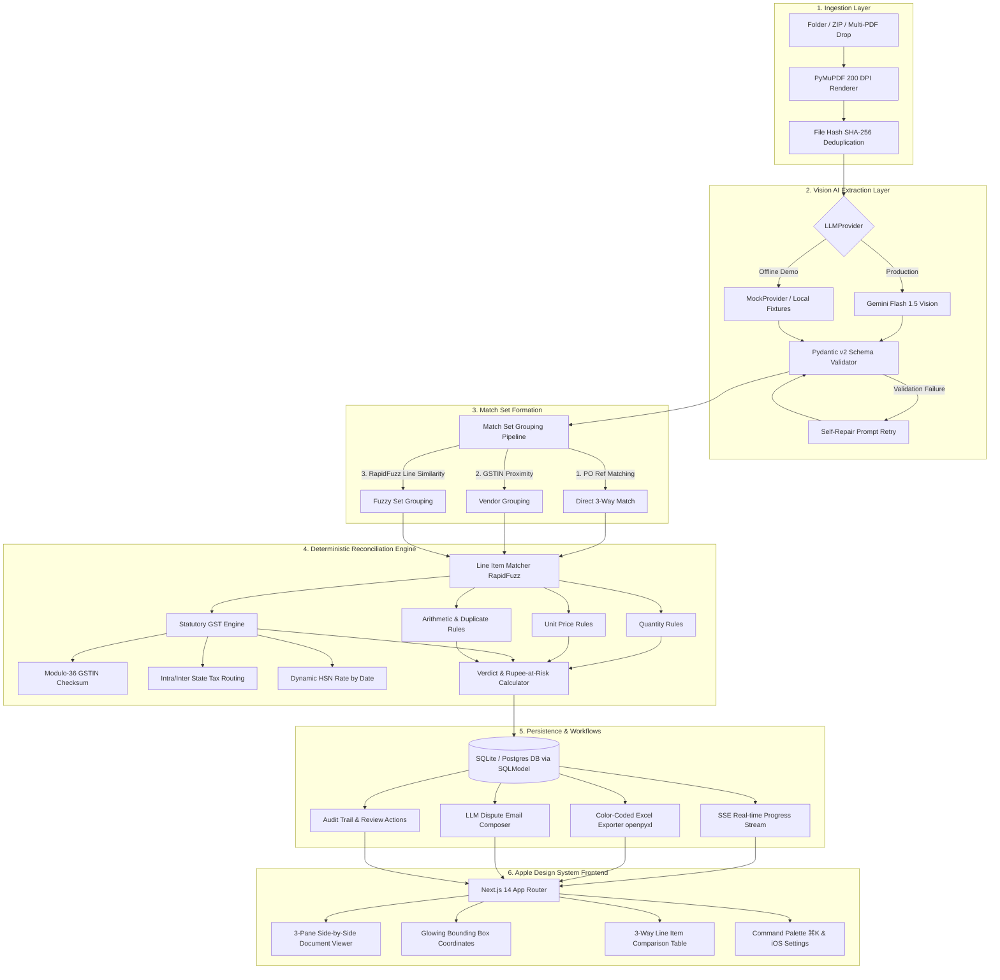
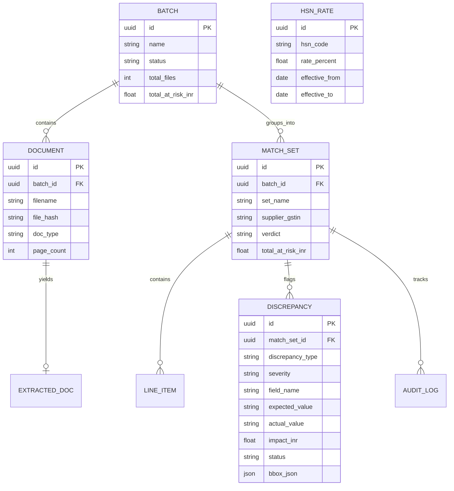

# Recon-Bot: System Architecture & Design Specification

Recon-Bot is an enterprise three-way matching platform engineered specifically for Indian manufacturing MSMEs (Micro, Small, and Medium Enterprises). It automates the verification of **Purchase Orders (PO)**, **Supplier Tax Invoices**, and **Goods Receipt Notes (GRN)**.

---

## 1. High-Level Architecture

---

## 2. Core Architectural Principles

### 2.1 The AI Extracts, The Code Decides
- **No Hallucinated Verdicts:** Large Language Models are employed solely as perceptual vision parsers to convert unstructured invoice PDFs into structured JSON.
- **Pure Python Rules:** Every commercial decision (Quantity tolerance, Unit Price divergence, CGST/SGST splitting, HSN slab adherence) is computed by deterministic, auditable Python code.

### 2.2 Statutory Indian GST Compliance Engine
Recon-Bot enforces statutory requirements defined in the **Central Goods and Services Tax (CGST) Act, 2017** and **Integrated Goods and Services Tax (IGST) Act, 2017**:

1. **GSTIN Modulo-36 Checksum Validation:**
   - 15-character alphanumeric GSTIN validation using the official alphanumeric weighting algorithm:
   $$\text{Weight} = 1 \text{ (even index)}, 2 \text{ (odd index)}$$
   $$\text{Quotient} = \lfloor (\text{Code} \times \text{Weight}) / 36 \rfloor, \quad \text{Remainder} = (\text{Code} \times \text{Weight}) \pmod{36}$$
2. **Tax Routing Verification (Sections 7 & 8 of the IGST Act):**
   - Intra-State supply (Supplier State Code $=$ Place of Supply) $\implies$ **CGST + SGST** (Mandatory 50/50 split).
   - Inter-State supply (Supplier State Code $\ne$ Place of Supply) $\implies$ **IGST**.
   - Flagging Section 16(2) ITC blocking if an intra-state supplier unlawfully charges IGST.
3. **Dynamic, Versioned HSN Rate Lookup:**
   - India's GST council restructured key slabs in 2025 (e.g. HSN 8708 auto components transitioned from 28% to 18% effective January 1, 2025).
   - Rates are dynamically resolved based on **Document Date**, never hardcoded.

---

## 3. Data Model (SQLModel / Relational)

---

## 4. Bounding Box & Document Page Rendering Pipeline

1. **PyMuPDF Rendering:** Each PDF page is rasterized at **200 DPI** using `fitz.Matrix(200/72, 200/72)` to balance OCR legibility with low memory footprint.
2. **Normalized Coordinate Space:** Bounding boxes are normalized to a standard $[0, 1000]$ integer grid:
   $$top = \frac{ymin}{1000} \times 100\%, \quad left = \frac{xmin}{1000} \times 100\%$$
3. **Interactive UI Overlay:** The Next.js frontend renders high-resolution page PNGs via `GET /api/documents/{id}/page/{n}.png` and positions SVG highlight overlays directly on discrepant cells.

---

## 5. Security & Privacy Design
- **Local SQLite / Self-Hosted Postgres:** No vendor lock-in; MSME invoices remain within the company's premises or private cloud.
- **Offline Mock Provider:** Full system features run offline using deterministic MSME fixtures for air-gapped defense or demo environments.
- **Immutable Audit Trail:** All override actions (`ACCEPTED`, `DISPUTED`, `RESOLVED`) record user identity, timestamp, previous state, and reason in `AuditLog`.
